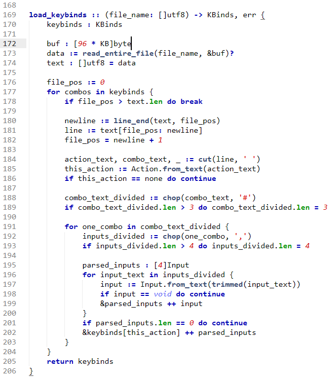

# Mara

Is a vibe-coded programming language. Directed by me, and written by Claude Opus 4.6 and all newer models. Mara's birthday is 3 Feb 2026.

## What it looks like

Hello world looks like this

```mara
module hello

main :: () {
    print("Hello there!")
}
```

And real code looks like that



Main feature of Mara is stack-like memory allocation. Everything in Mara lives until the end of scope. You can get data out of functions by returning it, or by passing in a block of memory and writing to it.

## Download

Ready-built compilers are on the [releases page](https://github.com/MagpieMcGraw/Mara/releases): `mara-windows-x64.zip` and `mara-linux-x64.tar.gz`. Unpack it anywhere and put its folder on PATH. On Windows that's all; on Linux, install clang and lld with your package manager.

## Building the compiler

The Mara compiler is written in [Odin](https://odin-lang.org/). You need
Odin on PATH to compile it. On Windows, Odin links with Visual Studio's linker, so building the compiler also needs the MSVC C++ build tools and the Windows SDK. Its source is in `src`. From the repo root:

```
odin build src -o:speed -out:mara.exe
```

(On Linux, `-out:mara`.) The compiler finds `code`, `runtime` and `tools` beside its executable, so keep it in the repo root.

Mara uses clang and lld to build it's executables. For the windows build, I placed these in the tools folder so you don't have to download LLVM. For the linux build, I recommend you download them via the package manager.

On windows, Mara needs nothing else: programs are built without the C library. Only a `-crt` build (for C code that calls the C library) needs the MSVC C++ build tools and the Windows SDK. You can download these from Microsoft.

## Using Mara

Go to the folder where you have your Mara source code and type

```
mara build <module-name>
```

If you don't pass a module name, Mara infers it from the current folder's
name. My typical workflow is:

```
cd C:\Code\Mara\Pounce
mara build
```

A folder can also have a `build.mara`, saying what to build and where else
to look for modules:

```
module build

use mara.build

game :: Build(){dirs = ["../engine"], icon = "game.ico", release = true}
tools :: Build(){module_name = "game_tools", dirs = ["../engine"]}
```

`mara build` then builds the one named as the folder (or the only one), and
`mara build tools` the other. `Build()` starts from the defaults; its fields
are in `code/build.mara`. `icon` is an `.ico` file, the program's icon on
Windows.

## License

See [LICENSE](LICENSE).
